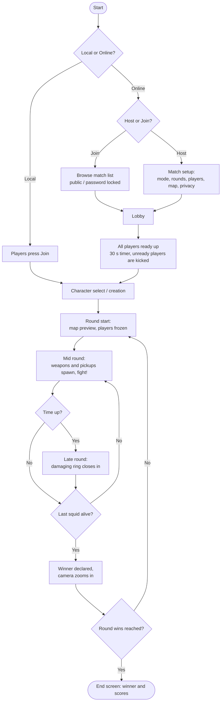

<div align="center">


# 🦑 SQUIDZ

### *Squids with guns!*

A side-profile multiplayer shooter where **the only way to move is by firing your weapon.**


**Developed by Something Studios**

</div>

---

## 📖 Table of Contents

- [About the Game](#-about-the-game)
- [Game Modes](#-game-modes)
- [Core Mechanic](#-core-mechanic)
- [World & Story](#-world--story)
- [Characters](#-characters)
- [Weapons](#-weapons)
- [Abilities & Pickups](#-abilities--pickups)
- [Hazards](#-hazards)
- [Controls](#-controls)
- [Match Flow](#-match-flow)
- [Progression & Economy](#-progression--economy)
- [Networking & Backend](#-networking--backend)
- [Art & Audio Direction](#-art--audio-direction)
- [Milestone V0.1 Scope](#-milestone-v01-scope)
- [Roadmap](#-roadmap)
- [Risk Management](#-risk-management)
- [Getting Started](#-getting-started)
- [The Team](#-the-team)
- [License](#-license)

---

## 🎮 About the Game

**SQUIDZ** is a side-profile, multiplayer shooter where movement is directly tied to combat. There is no walk button and no jump button: the only way to get around is by firing the wide array of weapons that spawn across the map. Players must master this unique mechanic to traverse the arena and defeat their opponents.

SQUIDZ offers a **chaotic yet skill-based experience** that can be enjoyed by both casual and competitive audiences.

**Highlights**

- 🔫 **Recoil is your engine.** Every weapon moves you differently.
- 🌊 **Underwater arenas** full of currents, vents, urchins, jellyfish and more.
- 🧑‍🤝‍🧑 **Co-op, versus and party play**, locally or online.
- 🎨 **Deep squid customization** unlocked through progression and a cosmetics store.
- 🎮 **Keyboard/mouse and controller support**, with left-hand and right-hand modes.

---

## 🕹️ Game Modes

| Mode | Players | Description |
| --- | --- | --- |
| **Campaign** | Up to 4 (co-op) | Complete a different objective each level (solve a puzzle, escape a maze, defeat a boss). At the end of each level, the squids fight each other in a VS match. Points are earned for objectives and for winning the VS match, and the player with the most points wins the level. |
| **VS** | Free-for-all or 2v2 | Competitive arena battles. Weapons spawn around the map and must be collected for an advantage. When only one player is left alive, they win the round and a new map is selected. The host can customize these options. |
| **Party** | Multiple | Casual mode where every round is a different minigame. One round might be VS, another might be basketball. The player with the most round wins takes the game. |

---

## 🚀 Core Mechanic

> **You move by shooting.**

Every weapon has its own *move style* (teleport, sideways, wavey and more), so choosing what to pick up is also choosing how you will travel. Mastering recoil, force and turn rate is the heart of the game.

Weapons are built from a flexible property system, which makes it easy to design new ones:

<details>
<summary><b>Weapon properties (click to expand)</b></summary>

| Property | Description |
| --- | --- |
| Damage | Damage dealt on hit |
| Projectile Speed | How fast the projectile moves |
| Fire Rate | How frequently the weapon fires |
| Ammo Max | How much ammo the weapon starts with |
| Turn Rate Modifier | How much player turning is affected |
| Force | How much the weapon pushes the player |
| `isHitscan` | No projectile; hit is based on line of sight |
| `isDot` | Produces a cloud that is not destroyed on hit and deals damage over time |
| Lifetime | How long the projectile lives in the world |
| `causesStatus` | Whether the projectile inflicts a status effect |
| `isEnvironmental` | Whether the projectile is affected by the environment |
| `isDelayed` | Whether the weapon has a delayed velocity |
| Delayed Impulse / Time | Force added after a delay, and how long the delay lasts |
| `isAOE` / AOE Size | Whether the weapon causes an area of effect, and how large it is |
| Timer | How long the player can hold the weapon |
| Self Damaging | Whether you can hit yourself |
| Charge Time | Time to charge before firing |
| AltFire | Replaces your ability with an alternate firing method (very limited) |
| Projectile Number | Number of projectiles fired |
| Spread | Angle at which projectiles can leave the fire point |
| Move Style | How the gun moves you: teleport, sideways, wavey, etc. |

</details>

---

## 🌊 World & Story

SQUIDZ takes place in a **post-apocalyptic ocean where squids have mutated into higher lifeforms.**

Four champion squids have held large territories for years. On the surface, AI entities have taken over the world and drained nearly all of its resources. Now they are turning to the sea to find new ones, and they are disrupting the squids' territory.

The squids must band together to destroy the AI, but the destruction of old territory also opens up opportunities too good to pass up. Every chance to reclaim lost land, or to seize land once held by a rival, gets taken.

---

## 🦑 Characters

The four champion squids are available in Campaign at all times. In VS mode, characters are unlocked through XP progression, and unlocking one makes its parts available in squid customization.

| | Squid | Personality | Rules through | Look |
| --- | --- | --- | --- | --- |
| 🟠 | **Inky** | Angry, weapon-obsessed, territorial | Survival of the fittest. Strength above all: *if you can take it, it is yours.* Claimed their reef through sheer strength and provides safety from greater threats. | Orange, muscular tentacles, blocky body, angry eyes, leather jacket |
| 🔵 | **Bloop** | Moral, heroic, brave, just | Popularity. Defender of the weak, appointed ruler through good deeds. | Blue, standard tentacles, arrow-shaped head, determined eyes, warm smile |
| 🟣 | **Tella** | Smart, nerdy, techy | Technology. Her utopian automated reef makes her the de facto ruler, and she wants more territory to keep up with energy and tech needs. | Purple, cuttlefish body, slim tentacles with a tech watch, goggles |
| 🟢 | **Coralino** | Hippy, free spirit, fun, vegan | Charm. Does not think of himself as a ruler, but is an accidental cult leader with fanatical followers. *"It's not a cult, it's a commune!"* | Green and yellow tie-dye, thin body, dopey eyes, tinted glasses, peace necklace |

### Squid customization

Every squid is assembled from parts: **pattern, primary and secondary colour, tentacles, head/body, eyes, eye colour, mouth expression, eyewear, hat and bodywear.**

---

## 🔫 Weapons

### Release 1 arsenal

| Weapon | Role | Description |
| --- | --- | --- |
| **Pistol / Bubble Shot** | Basic shot | Average fire rate and damage. Fires small bluish bubbles. |
| **Minigun** | Super | Large minigun with a wind-up whine and a bright, heavy muzzle flash. |
| **Flamethrower** | Status | Continuous fire, low damage, applies *burn*. |
| **Swordfish** | Melee | A literal swordfish that swishes through the water. |
| **Catfish Launcher** | Delayed rocket | Fires a slow, aimable missile (half cat, half fish) that applies an impulse after a delay. Anti-tank launcher with a fishbowl attached. |

### Planned arsenal

SMG · Shotgun · Eel Gun · Guided Launcher · Death Laser · Nuke · Sniper · Freeze Ray · Poison Spray · Mine Thrower · Blender · Cannon · Bubble Gun · Shockwave Cannon · Charge Gun · Belt Fish

---

## ✨ Abilities & Pickups

| Name | Description |
| --- | --- |
| ❤️ **Health Pickup** | Heals the player a certain amount on pickup. |
| 🛡️ **Shield** | Temporarily makes the player invulnerable (either slowing them or preventing them from damaging others). |
| 🖤 **Ink Cloud** | Places an opaque ink spot. Enemies who move through it are spun in a random direction. |

---

## ⚠️ Hazards

Arenas are packed with environmental dangers that can punish bad navigation, or turn into weapons when you push an opponent into them.

| Hazard | Description |
| --- | --- |
| 🦔 **Urchin** | Static spikes that damage players on contact. |
| 🌀 **Currents** | Continuous streams that push players in another direction. They can be overcome, but they slow you down. |
| 🌋 **Geyser / Vent** | Bursts of water that forcibly push players. |
| 🪼 **Jellyfish** | Floating obstacles that damage and briefly stun on contact. |
| ☠️ **Dangerous Water** | Areas that deal continuous damage. The look depends on the map (boiling in a volcano, polluted in a dumpster). |
| 🗿 **Petrification** | Slows the player and builds up petrification. When full, the player is briefly locked in place. |
| 🐍 **Eels** | Hide in holes and jump out to attack, with an effect similar to jellyfish. |
| 🐡 **Pufferfish** | Float around, damaging and pushing players inside their area of effect. |
| 🎣 **Fishing Hook** | Grabs a player and kills them unless they shoot the hook to escape. |
| 🐟 **Blocking Obstacles** | Slow movers (sunfish, manta rays...) that block both shots and movement. |

### Map requirements

Each map defines: player spawn points, hazards, weapon spawn points, pickup spawn points, static walls, a cosmetic theme and a gameplay theme.

<div align="center">

| Arena concept | Symmetric concept |
| :---: | :---: |
|  |  |

*Early hand-drawn map layouts.*

</div>

---

## 🎛️ Controls

The UI is fully navigable with both **keyboard/mouse** and **controller**. Controller layouts support **left-hand and right-hand modes**.

| Action | PC | Controller |
| --- | --- | --- |
| Fire (move) | `W` | `RT` |
| Quick switch weapon | `Q` / `E` | `LB` / `RB` |
| Select weapon | `1` - `3` | Hold `LB` |
| Grab / swap weapon | `F` | Bottom button |
| Rotate | `A` / `D` | Left joystick |
| Use ability | `Shift` / `Ctrl` / `Space` | `LT` |
| Use pickup | `S` | Left button |
| Pause | `Esc` | `Start` |
| UI navigation | Mouse | Joysticks |
| Emotes | Hold `T` | Hold top button |
| Ping | Tap `T` | Tap top button |

---

## 🔄 Match Flow



**Round highlights**

- **Round start:** a timer begins, players cannot move, and the map moves to show off its mechanics.
- **Mid round:** weapons and abilities spawn. Score is earned for moving, dealing damage and collecting items.
- **Player death:** while more than one player is alive, the fallen player becomes a **ghost squid**. Ghosts can slow living players by overlapping them and can carry pickups around, but cannot otherwise interact.
- **Late round:** after the timer ends, a damaging ring slowly closes in.
- **Round end:** last squid alive wins. In case of a tie, the player first on the score list wins.
- **Game end:** the first player to reach the set number of round wins takes the match.

---

## 📈 Progression & Economy

### XP and levels

After every Campaign and VS match, players earn XP based on performance. Levels unlock **cosmetics, characters, emotes and maps.** Completing the progression track is designed to take roughly **200 hours.**

### Currency and store

Currency is earned at the end of each game and spent in the store.

| Rarity | Approximate time to earn |
| --- | --- |
| Basic | ~0.5 hours (a couple of games) |
| Rare | ~1.5 hours (a day or two of play) |
| Exceptional | Weeks of gameplay |

**Store items:** emotes, squid parts, key chains, gun cosmetics, colours and patterns, faces and maps.

### Accounts

Player accounts are tied to **Steam / Xbox / PlayStation IDs.** All stats and unlocks are saved **server-side**, with very little (if anything) stored on the client.

---

## 🌐 Networking & Backend

| Mode | Method |
| --- | --- |
| Campaign | Peer-to-peer |
| Party | Peer-to-peer |
| Casual VS | Peer-to-peer |
| Ranked | Relay server |

- **Beta launch:** all modes run peer-to-peer.
- **Database:** a SQL relational database stores ranked player stats, currency, level, XP, owned cosmetics and player statistics.
- **Security:** anti-cheat is not planned for beta. It will be needed later for Ranked. Cheating in solo and casual modes is not a concern.
- **Servers:** server costs are relatively low. At full release, the plan is to pay for **3 months** of server space to gauge reception and requirements.

### Water system

The plan is to start with **real water physics** (ripples and cloud dispersal driven by the movement of players and entities), and fall back to a **faked, VFX-manager-driven** system if it proves too complicated or expensive.

---

## 🎨 Art & Audio Direction

### Visual style

**Cartoonish, colourful and not realistic.** Bright, contrasting colours, soft edges, simple smooth shapes and visible texture, with a SpongeBob-style charm.

### Audio

The sound design leans on cartoon slapstick and underwater textures, for example a bubble pop for the pistol, a roaring burn for the flamethrower, an angry cat meow for the Catfish Launcher, and a slapstick slip when a squid hits an ink cloud. Planned audio includes main menu and per-map match music, weapon sounds, pickup and ability cues, hazard sounds, UI sounds and a victory jingle.

<div align="center">

| Player layout concept | HUD concept |
| :---: | :---: |
|  |  |

*Early hand-drawn layout and HUD sketches (player icon, ammo icons, tentacle health bar, ability bar).*

</div>

---

## 🎯 Milestone V0.1 Scope

### In scope

- [ ] Fully working VS mode
- [ ] Network multiplayer
- [ ] Database functionality
- [ ] Working weapon system
- [ ] Working movement system
- [ ] Water system
- [ ] Concept art
- [ ] Progression system
- [ ] 4 working weapons
- [ ] 2 squid characters with stats
- [ ] At least 1 map

### Completion criteria

V0.1 is complete when:

- [ ] The game is downloadable
- [ ] A VS match can be completed over a network connection
- [ ] Progress is not lost
- [ ] A character select screen is available before a match
- [ ] A base weapon and 3 equippable weapons are available

---

## 🗺️ Roadmap

| Phase | Focus |
| --- | --- |
| **Phase 1: Planning** | Project initiation, network research, controls, progression, store/economy, accounts, maps and hazards, water system, UI, dependency injection, weapons, characters, round management, database model, campaign story |
| **Phase 2: Development** | Database requirements, project setup, repository setup and core gameplay systems |
| **Release 1.0** | Full release, target date: **November 28, 2028** |

---

## 🛡️ Risk Management

| Risk | Impact | Probability | Plan |
| --- | --- | --- | --- |
| Cannot find a student 3D asset artist | High | Medium | **A)** A team member learns basic Blender skills and creates acceptable, below-standard assets. **B)** Set aside budget to pay an asset artist. |

---

## 🛠️ Getting Started

### Requirements

- [Unity Hub](https://unity.com/download) and the Unity Editor version listed in [`ProjectSettings/ProjectVersion.txt`](ProjectSettings/ProjectVersion.txt)
- [Git](https://git-scm.com/downloads)

### Run the project

```bash
# 1. Clone the repository
git clone https://github.com/AngelicaCuadrado/SquidzWithGunz.git

# 2. Open Unity Hub > Add > select the cloned folder
#    (use the editor version from ProjectSettings/ProjectVersion.txt)

# 3. Open the scene: Assets/Scenes/SampleScene.unity
```

The first launch takes a while, because Unity regenerates the `Library/` folder (it is intentionally not tracked by Git).

### Contributing workflow

```bash
git checkout -b feature/your-feature-name
git add .
git commit -m "Describe your change"
git push -u origin feature/your-feature-name
```

Then open a Pull Request on GitHub. Please commit with Unity closed, and never commit `Library/`, `Temp/` or `Logs/`.

---

## 👥 The Team

**Something Studios**

| Name | Notes |
| --- | --- |
| **Ido Isaac** | Project setup |
| **Shane Duffney** | Core team |
| **Angelica Cuadrado** | Core team |
| **Alfonso Raziel Mendoza** | Database requirements |
| **Naomi Mendoza** | Core team |

---

## 📄 License

© 2026 Something Studios. All rights reserved.

*SQUIDZ is a work in progress. Features, names and plans in this document may change during development.*

<div align="center">

**Made with 🦑 and way too many bubbles.**

</div>
